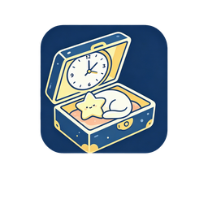

# ChroDen (时栖匣)

[中文](README.zh.md)

An alarm and routine app that ties a virtual pet's growth to verified wake-ups and healthy sleep habits.

## Features

- **Wake alarms with weekday repetition, snooze limits, gradual volume, full-screen ringing**
- **Five accessible dismissal tasks (maths, memory match, shake, QR scan, photo), combinable**
- **Bedtime and custom reminders plus step-by-step routines with per-step timers**
- **Daily settlement of verified wake/bedtime/routine events into "Time Grains", the only currency**
- **A pet with four growth stages and two appearance paths — no death, no level loss, no scolding**
- **Routine logs and insights: 7-day sleep onset, wake consistency, weekly reports**
- **Shop and collection, Chinese/English switching, encrypted local backup export/import**

## Release Status

The official release has not yet been published. Please watch the GitHub / Gitee Releases page for updates.

GitHub: https://github.com/KylinLabAI/ChroDen-App
Gitee:  https://gitee.com/KylinLab/ChroDen-App

## About

ChroDen binds a virtual pet-raising mechanic to alarm clocks and routine management — waking on time and keeping regular habits become the conditions for raising the pet, turning better sleep habits into a fun game.

## Contact

kylinlab.tech
