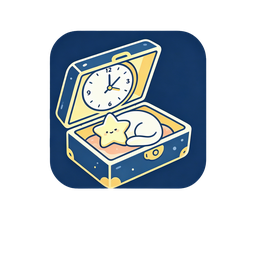

# 时栖匣 ChroDen

[English](README.md)

一款将虚拟萌宠成长与真实起床、规律作息绑定的闹钟与作息管理应用，用趣味养成改善熬夜赖床。

## 功能特性

- **起床闹钟（工作日重复、贪睡上限、渐强音量、全屏响铃）**
- **五种可无障碍替代的关铃任务（算术、记忆配对、摇一摇、扫码、拍照），可叠加**
- **就寝及自定义提醒，支持带每步计时器的分步例行流程**
- **每日将已核实的起床/就寝/例行事件结算为唯一货币「时光谷粒」**
- **萌宠含四个成长阶段与两条外观路线；永不死亡、不掉级、不责备**
- **作息日志与洞察：7 天入睡时间、起床一致性、周报与洞察卡片**
- **商店与收藏、中英切换、加密本地备份导出/导入**

## 发布状态

官方版本尚未发布，敬请关注 GitHub / Gitee 的 Releases 页面获取最新动态。

GitHub: https://github.com/KylinLabAI/ChroDen-App
Gitee:  https://gitee.com/KylinLab/ChroDen-App

## 简介

时栖匣是一款绑定电子宠物养成机制的闹钟与作息管理应用，将按时起床、规律作息转化为饲养萌宠的必备条件，以趣味养成改善熬夜、赖床等不良作息习惯。

## 联系方式

kylinlab.tech
